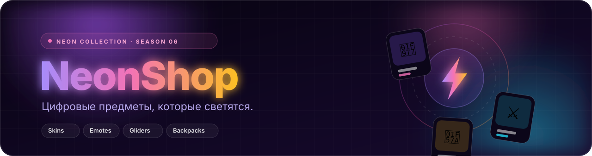
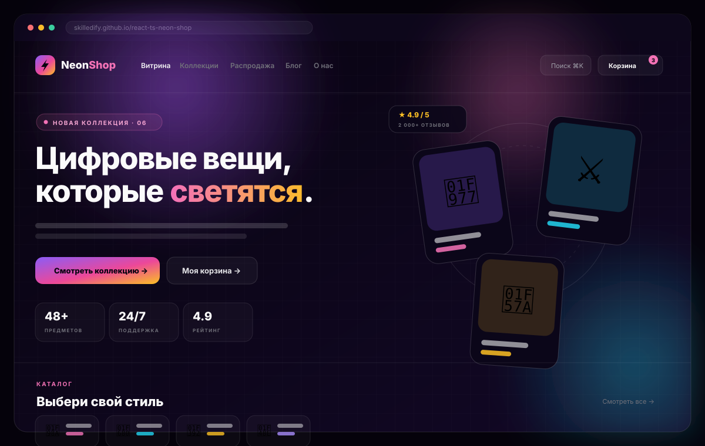
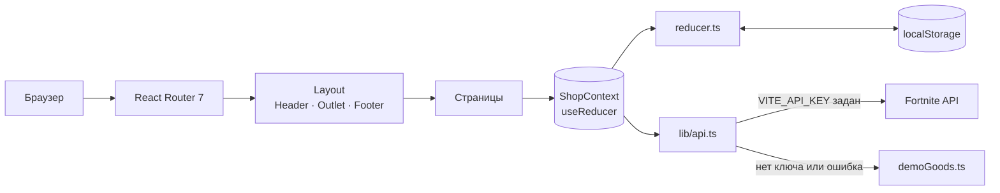

<div align="center">
  
</div>

<h1 align="center">NeonShop</h1>

<p align="center">
  <strong>Витрина цифровых предметов с характером: неоновая коллекция, мгновенная выдача и интерфейс, который приятно трогать.</strong>
</p>

<p align="center">
  <a href="https://github.com/skilledify/react-ts-neon-shop/actions/workflows/deploy.yml"></a>
  <a href="https://skilledify.github.io/react-ts-neon-shop/"></a>
  <a href="https://react.dev/"></a>
  <a href="https://www.typescriptlang.org/"></a>
  <a href="https://vite.dev/"></a>
  <a href="https://tailwindcss.com/"></a>
  <a href="https://reactrouter.com/"></a>
</p>

<p align="center">
  <a href="https://skilledify.github.io/react-ts-neon-shop/">Демо</a> ·
  <a href="#-возможности">Возможности</a> ·
  <a href="#-быстрый-старт">Быстрый старт</a> ·
  <a href="#-маршруты">Маршруты</a> ·
  <a href="#-архитектура">Архитектура</a> ·
  <a href="#-деплой">Деплой</a>
</p>

---

## 🖼️ Превью

<div align="center">
  
</div>

> Иллюстрация интерфейса, а не скриншот. Живую версию смотрите в [демо](https://skilledify.github.io/react-ts-neon-shop/).

## ✨ О проекте

**NeonShop** — учебно-боевой проект витрины цифровых предметов: скины, кирки, эмоции, глайдеры и рюкзаки. Приложение выросло из CRA-заготовки на React 17 + Materialize и было переписано на современный стек: **Vite + React 19 + TypeScript + React Router 7 + Tailwind CSS 4**.

Корзина, избранное, сравнение, профиль и отзывы живут в `localStorage`, поэтому витрина полностью работоспособна без бэкенда. Если задан ключ Fortnite API — каталог загружается из сети, если нет — используется локальная демо-коллекция, и приложение выглядит одинаково хорошо в любом окружении.

- 🎨 **Дизайн-система на Tailwind 4** — неоновые градиенты, стеклянные поверхности, кастомные keyframes.
- ⚡ **SPA без сервера** — состояние в `Context + useReducer`, всё сохраняется между перезагрузками.
- 📱 **Адаптивность** — от мобильного меню-drawer до широкой сетки каталога.
- ♿ **Доступность** — `aria`-атрибуты, фокус-стили и поддержка `prefers-reduced-motion`.
- 🚀 **CI/CD** — автоматический деплой на GitHub Pages через GitHub Actions.

## 🚀 Возможности

### 🛍️ Витрина

- Hero-блок с плавающими карточками и aurora-градиентами
- Бегущая строка преимуществ
- Поиск с `useDeferredValue`
- Фильтры по категориям и 4 сортировки
- Skeleton-загрузка каталога
- Автоматический fallback на демо-данные

### 🛒 Корзина и заказ

- Выдвижная корзина-drawer
- Изменение количества и удаление
- Промокоды со скидкой поверх распродажи
- Оформление заказа: доставка, оплата, комментарий
- История заказов со статусами

### ❤️ Персональное

- Избранное с бейджем в шапке
- Сравнение предметов в таблице
- Недавно просмотренные
- Локальный профиль с аватаром
- Тосты-уведомления на каждое действие

### 📚 Контент

- Блог с полноценными статьями
- Коллекции по категориям
- Распродажа с таймером до дропа
- Отзывы с рейтингом и формой публикации
- Страницы «О проекте», FAQ и поддержка

## 🧰 Стек

| Технология | Роль в проекте |
| --- | --- |
| ⚛️ **React 19** | UI и хуки (`useDeferredValue`, `useMemo`, `useReducer`) |
| 🔷 **TypeScript 5.7** | Строгие типы данных, стора и API |
| ⚡ **Vite 6** | Dev-сервер, сборка, `base` для GitHub Pages |
| 🧭 **React Router 7** | Декларативные маршруты, `Link`, `NavLink`, `Outlet` |
| 🎨 **Tailwind CSS 4** | Тема, keyframes и утилиты через `@tailwindcss/vite` |
| 🧠 **Context + useReducer** | Единое состояние магазина и действия |
| 💾 **localStorage** | Персист корзины, заказов, профиля и отзывов |
| 🤖 **GitHub Actions** | Сборка и публикация на GitHub Pages |

## ⚡ Быстрый старт

**Требования:** Node.js `>= 20` и npm.

```bash
# 1. Клонируйте репозиторий
git clone https://github.com/skilledify/react-ts-neon-shop.git
cd react-ts-neon-shop

# 2. Установите зависимости
npm install

# 3. Запустите dev-сервер
npm run dev
```

Приложение откроется на [http://localhost:5173](http://localhost:5173).

### Скрипты

| Команда | Что делает |
| --- | --- |
| `npm run dev` | Dev-сервер Vite с HMR |
| `npm run build` | Проверка типов + прод-сборка в `dist/` |
| `npm run preview` | Локальный предпросмотр прод-сборки |
| `npm run typecheck` | `tsc --noEmit` без сборки |

## 🗺️ Маршруты

| Путь | Страница | Что внутри |
| --- | --- | --- |
| `/` | 🏠 Витрина | Hero, тикер, каталог, поиск, фильтры |
| `/collections` | 🧩 Коллекции | Категории и количество предметов |
| `/collections/:slug` | 🗂️ Категория | Предметы выбранной коллекции |
| `/sale` | 🔥 Распродажа | Скидки и таймер до следующего дропа |
| `/product/:id` | 🛍️ Товар | Галерея, цена, отзывы, похожие предметы |
| `/cart` | 🛒 Корзина | Состав, промокод, оформление заказа |
| `/wishlist` | ❤️ Избранное | Отмеченные предметы |
| `/compare` | ⚖️ Сравнение | Таблица характеристик |
| `/blog` | 📰 Блог | Список статей |
| `/blog/:slug` | 📖 Статья | Полный текст и подборка товаров |
| `/profile` | 👤 Профиль | Имя, контакты, аватар |
| `/orders` | 📦 Заказы | История и статусы |
| `/support` | 💬 Поддержка | Каналы связи и форма обращения |
| `/faq` | ❓ FAQ | Частые вопросы |
| `/about` | 💡 О проекте | История, ценности, команда |
| `*` | 🚫 404 | Дружелюбная заглушка |

## 🏗️ Архитектура



### Структура проекта

```text
src/
├── components/        # UI-кит: шапка, подвал, карточки, корзина, toast, иконки
│   ├── Header.tsx     # Навигация, поиск, счётчики
│   ├── CartDrawer.tsx # Выдвижная корзина
│   ├── SearchPalette.tsx
│   └── ...
├── data/              # Демо-коллекция, статьи, стартовые отзывы
├── lib/               # API, форматирование, промокоды, slugify, расчёты корзины
├── pages/             # 16 страниц приложения
├── store/             # ShopContext, reducer, типы действий и персист
├── App.tsx            # Декларативные маршруты
├── main.tsx           # BrowserRouter + ShopProvider
├── index.css          # Tailwind 4: тема, keyframes, утилиты
└── types.ts           # Общие доменные типы
```

## 🔌 Данные и API

Без ключа приложение работает на локальной демо-коллекции из `src/data/demoGoods.ts`.
Чтобы загружать предметы из [Fortnite API](https://fortniteapi.io), создайте `.env` по образцу `.env.example`:

```env
VITE_API_KEY=ваш_ключ
VITE_API_URL=https://fortniteapi.io/v1/shop?lang=ru
```

| Сценарий | Поведение |
| --- | --- |
| Ключ не задан | Мгновенно показывается демо-коллекция |
| Ключ задан, API ответил | Каталог загружается из сети, в каталоге скрыт бейдж «демо» |
| Ошибка или пустой ответ | Автоматический откат на демо-коллекцию |

## 💾 Состояние и хранение

Всё живёт в `ShopContext` и синхронизируется с `localStorage` под ключом `react-ts-neon-shop:state-v2`:

| Данные | Сохраняется |
| --- | :---: |
| Корзина и применённый промокод | ✅ |
| Избранное | ✅ |
| Сравнение | ✅ |
| Недавно просмотренные | ✅ |
| Заказы | ✅ |
| Профиль | ✅ |
| Отзывы | ✅ |

Кнопка сброса данных возвращает стор к исходному состоянию — удобно для проверки демо.

## 🎨 Дизайн-система

| Токен | Цвет | Настроение |
| --- | --- | --- |
| `night-950` | `#06050d` | Глубокий космический фон |
| `violet-500` | `#8b5cf6` | Основа неона |
| `fuchsia-500` | `#d946ef` | Акцент и свечение |
| `cyan-400` | `#22d3ee` | Холодный контраст |
| `amber-300` | `#fcd34d` | Тёплый акцент и рейтинг |

- **Шрифты:** [Manrope](https://fonts.google.com/specimen/Manrope) для текста и [Space Grotesk](https://fonts.google.com/specimen/Space+Grotesk) для заголовков.
- **Анимации:** `fade-up`, `float`, `aurora`, `marquee`, `shimmer`, `slide-in`, `toast-progress`, `pop`.
- **Доступность:** при `prefers-reduced-motion: reduce` анимации отключаются.
- **Поверхности:** стекло, размытие, тонкие градиентные бордеры и мягкие цветные тени.

## 🚢 Деплой

Проект публикуется автоматически на **GitHub Pages** при пуше в `main` или вручную из вкладки **Actions**.

```text
push → main
  └─ npm ci → npm run build → dist/
       ├─ 404.html   ← копия index.html для глубоких ссылок (SPA-fallback)
       ├─ .nojekyll
       └─ upload-pages-artifact → deploy-pages
```

- 🌐 **Прод:** <https://skilledify.github.io/react-ts-neon-shop/>
- ⚙️ **Workflow:** [`.github/workflows/deploy.yml`](.github/workflows/deploy.yml)
- 🧭 **Base path:** в прод-сборке Vite использует `base: '/react-ts-neon-shop/'`, а роутер — соответствующий `basename`.
- 🔁 **SPA-фоллбэк:** GitHub Pages не умеет отдавать `index.html` для вложенных путей, поэтому workflow копирует его в `404.html` — ссылки вида `/blog/:slug` и `/product/:id` открываются корректно.

Первичная настройка репозитория (один раз): **Settings → Pages → Build and deployment → GitHub Actions**.

## 🤝 Участие

Идеи и pull request'ы приветствуются:

1. Форкните репозиторий и создайте ветку: `git checkout -b feat/новая-фича`.
2. Внесите изменения и проверьте сборку: `npm run build`.
3. Откройте PR с описанием того, что изменилось и зачем.

## 🗺️ Планы

- [ ] Unit-тесты для корзины, промокодов и редьюсера (Vitest)
- [ ] Переключатель светлой темы
- [ ] Скелетоны для страниц коллекций и блога
- [ ] PWA-манифест и офлайн-режим
- [ ] Скриншот-тесты ключевых страниц

---

<div align="center">

<strong>Сделано с ❤️ и неоном.</strong>

Если проект понравился — поставьте ⭐, это лучший способ поддержать автора.

</div>
